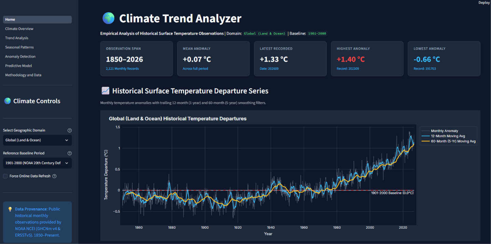
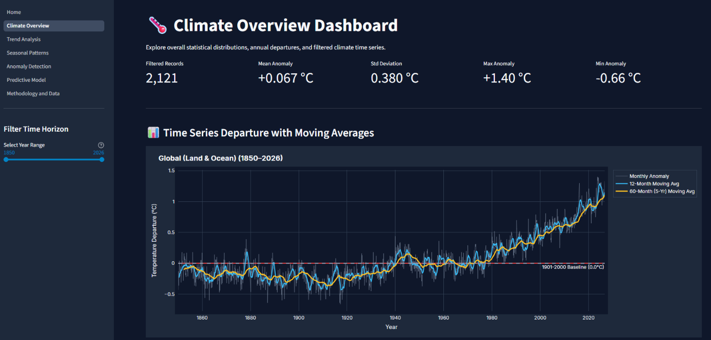
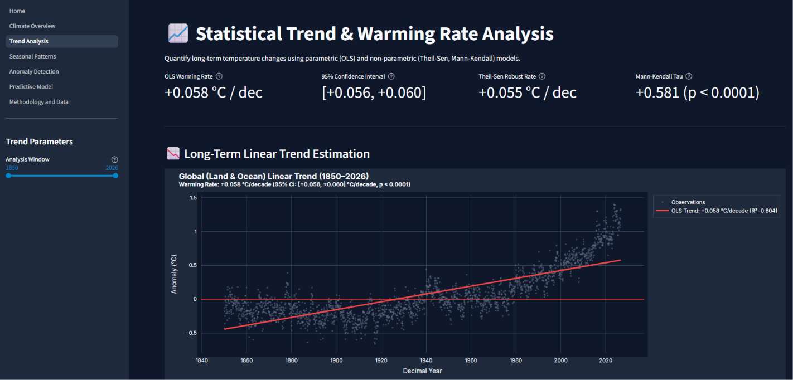
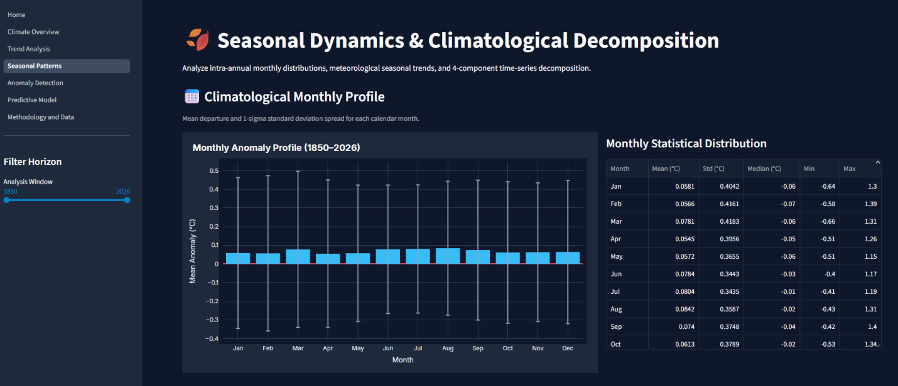

# 🌍 Climate Trend Analyzer

[](https://www.python.org/)
[](https://streamlit.io/)
[](LICENSE)
[](tests/)

A reproducible, professional, student-friendly data analytics application that investigates historical global temperature departures, estimates long-term warming trends, decomposes seasonal dynamics, and detects statistical anomalies using documented, transparent methods.

---

## 📌 Table of Contents
* [Overview](#-overview)
* [Application Screenshots](#-application-screenshots)
* [Key Features](#-key-features)
* [Dataset Provenance & Attributes](#-dataset-provenance--attributes)
* [Project Architecture](#-project-architecture)
* [Installation & Quickstart (Windows & POSIX)](#-installation--quickstart)
* [Running the Application](#-running-the-application)
* [Running Automated Tests](#-running-automated-tests)
* [Methodological Principles](#-methodological-principles)
* [Limitations & Disclaimers](#-limitations--disclaimers)
* [License](#-license)

---

## 📖 Overview
Understanding planetary temperature dynamics requires empirical observation, robust statistical estimation, and transparent communication. 

The **Climate Trend Analyzer** ingests real-world historical surface temperature anomaly series from the **National Oceanic and Atmospheric Administration (NOAA NCEI)** spanning **1850 to the present** (>2,100 monthly observations). It provides:
1. Long-term decadal warming rate estimation via **Ordinary Least Squares (OLS)** and the non-parametric **Theil-Sen estimator** with 95% confidence intervals.
2. Monotonic trend verification using the **Mann-Kendall test** and serial autocorrelation diagnostics (**Durbin-Watson**, lag-1 autocorrelation).
3. **Seasonal cycle decomposition** and intra-annual comparisons across climatological eras.
4. Transparent **statistical anomaly detection** (Z-score thresholds, Tukey's IQR fences, and unsupervised Isolation Forests) with strict non-alarmist scientific disclaimers.
5. Interactive, publication-ready **Plotly visualizations** and filtered data exports.

---

## 📸 Application Screenshots

<div align="center">
<table>
  <tr>
    <td></td>
    <td></td>
  </tr>
  <tr>
    <td></td>
    <td></td>
  </tr>
</table>
</div>

---

## ✨ Key Features

| Analytical Module | Description | Core Output / Metric |
| :--- | :--- | :--- |
| **🌡️ Climate Overview** | Comprehensive dashboard of multi-decadal observations, range filters, and anomaly distributions. | Min/Max/Mean Anomaly, Obs Count, Climatological Normal |
| **📈 Trend Analysis** | Parametric (OLS) & Non-parametric (Theil-Sen, Mann-Kendall) slope modeling. | Rate in **°C / decade**, 95% Confidence Interval, $p$-value, $R^2$ |
| **🍂 Seasonal Patterns** | Intra-annual monthly variations, decade-by-decade boxplot profiles, and additive time-series decomposition. | Monthly anomalies, DJF/MAM/JJA/SON distributions, Seasonal Component |
| **🚨 Anomaly Detection** | Transparent identification of unusual departures using Z-Score, Tukey IQR, and Isolation Forest. | Flagged observation dates, departure values, downloadable anomaly logs |
| **🔮 Predictive Modeling** | Responsible, educational baseline forecasting using strict chronological train/test splitting. | MAE, RMSE, $R^2$ benchmarked against baseline persistence |

---

## 🛰️ Dataset Provenance & Attributes

* **Primary Source**: NOAA National Centers for Environmental Information (NCEI) — *Climate at a Glance (CAG)*.
* **Underlying Networks**:
  * Land: Global Historical Climatology Network Monthly (GHCNm v4) (Menne et al., 2018).
  * Ocean: Extended Reconstructed Sea Surface Temperature (ERSSTv5) (Huang et al., 2020).
* **Reference Baseline**: 1901–2000 (20th-century average), with options for pre-industrial (1850–1900) or satellite-era (1951–1980) re-centering.
* **Units**: Degrees Celsius (°C).
* **Observation Frequency**: Monthly (1850–Present).
* **Geographical Coverage**: Global (Land & Ocean), Northern Hemisphere, Southern Hemisphere, Land-only, and Ocean-only series.
* **Data Integrity**: Real observations are stored in `data/raw/`. Synthetic test datasets are strictly isolated in `tests/fixtures/` and explicitly tagged with `is_synthetic = True`.

---

## 🏗️ Project Architecture

```
climate-trend-analyzer/
├── .github/
│   └── workflows/
│       └── tests.yml             # GitHub Actions automated CI testing workflow
├── .streamlit/
│   └── config.toml               # Streamlit theme & layout configuration
├── app/
│   ├── Home.py                   # Main Streamlit dashboard application
│   └── pages/
│       ├── 1_Climate_Overview.py
│       ├── 2_Trend_Analysis.py
│       ├── 3_Seasonal_Patterns.py
│       ├── 4_Anomaly_Detection.py
│       ├── 5_Predictive_Model.py
│       └── 6_Methodology_and_Data.py
├── data/
│   ├── raw/                      # Real public NOAA NCEI CSV datasets (1850-Present)
│   └── README.md                 # Data provenance, data dictionary, licensing
├── docs/
│   ├── dataset_documentation.md  # Detailed documentation on sources & variables
│   └── methodology.md            # Mathematical formulations & statistical proofs
├── notebooks/
│   ├── 01_exploratory_data_analysis.ipynb
│   └── README.md
├── src/                          # Core analytical Python package
│   ├── __init__.py
│   ├── data_loader.py            # Ingestion, local caching, and remote fallback
│   ├── data_cleaner.py           # Schema verification, missing values, sanity checks
│   ├── preprocessing.py          # Rolling windows, baseline shifting, annual means
│   ├── trend_analysis.py         # OLS, Theil-Sen, Mann-Kendall, Autocorrelation
│   ├── seasonal_analysis.py      # Monthly cycles, seasonal groupings, decomposition
│   ├── anomaly_detection.py      # Z-score, Tukey IQR, Isolation Forest
│   ├── predictive_model.py       # Chronological train/test split & regression baseline
│   └── visualizations.py         # Publication-grade interactive Plotly chart generators
├── tests/                        # Automated Pytest suite
│   ├── __init__.py
│   ├── fixtures/
│   │   ├── __init__.py
│   │   └── synthetic_series.py   # Isolated mock data for algorithmic tests
│   ├── test_data_loader.py
│   ├── test_data_cleaner.py
│   ├── test_preprocessing.py
│   ├── test_trend_analysis.py
│   ├── test_seasonal_analysis.py
│   ├── test_anomaly_detection.py
│   ├── test_predictive_model.py
│   └── test_visualizations.py
├── .gitignore
├── app.py                        # Root launcher for Streamlit Cloud
├── LICENSE                       # MIT License
├── main.py                       # Command-line interface & application runner
├── pyproject.toml                # Project packaging and metadata
├── README.md                     # Project documentation
└── requirements.txt              # Pinned, tested dependencies
```

---

## ⚙️ Installation & Quickstart

### Prerequisites
* Python 3.10 or 3.11 installed.
* Git installed.

### 1. Clone the Repository
```bash
git clone https://github.com/your-username/climate-trend-analyzer.git
cd climate-trend-analyzer
```

### 2. Create and Activate a Virtual Environment
**On Windows (PowerShell):**
```powershell
python -m venv .venv
.venv\Scripts\Activate.ps1
```

**On macOS / Linux (bash/zsh):**
```bash
python3 -m venv .venv
source .venv/bin/activate
```

### 3. Install Dependencies
```bash
pip install --upgrade pip
pip install -r requirements.txt
```

---

## 🚀 Running the Application

Launch the interactive dashboard with either method:

**Method A (CLI Launcher):**
```bash
python main.py
```

**Method B (Direct Streamlit Execution):**
```bash
streamlit run app.py
```
or
```bash
streamlit run app/Home.py
```

Then open your browser at `http://localhost:8501`.

---

## 🧪 Running Automated Tests

Run the full analytical verification suite with verbose output:
```bash
pytest -v
```

To run with coverage reporting:
```bash
pytest --cov=src --cov-report=term-missing tests/
```

---

## 📐 Methodological Principles

1. **Statistical Honesty**: Linear trends do not imply causation without physical mechanism verification.
2. **Serial Correlation Awareness**: Geophysical data exhibits strong positive autocorrelation; uncorrected OLS standard errors underestimate variance. Both parametric and non-parametric tests are reported.
3. **Rigorous Anomaly Framing**: An anomaly indicates an unusual statistical departure from the reference distribution; it is never automatically reported as a proven extreme weather disaster.
4. **No Arbitrary Imputation**: Missing records are flagged, never silently zero-filled.
5. **No Data Leakage**: Predictive models strictly employ chronological train/test splits.

---

## 📄 License
This project is licensed under the [MIT License](LICENSE).
Public climate observation data is provided courtesy of the NOAA National Centers for Environmental Information and NASA Goddard Institute for Space Studies.
